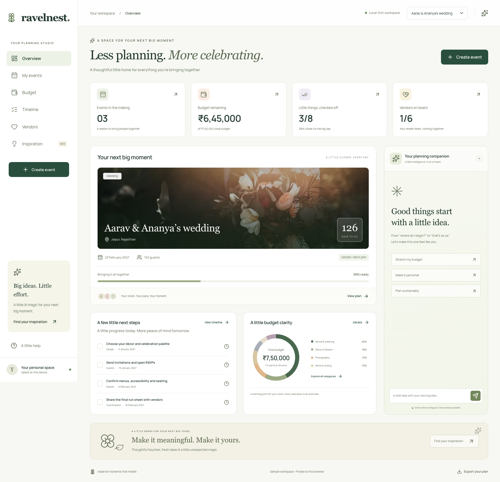
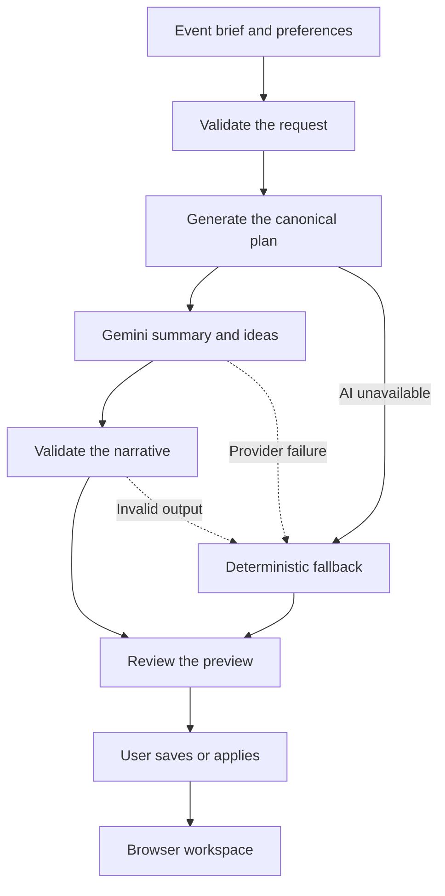

# RavelNest

### Bring people together. Keep the planning together.

RavelNest is a GenAI-powered planning studio for weddings, birthdays, and community events. It turns an event brief into a connected budget, timeline, vendor checklist, and collection of personalized ideas, with a workspace to carry those plans through.

Built for **Google Promptwars** using Next.js, React, TypeScript, Google Gemini, and plain CSS. The planning engine calculates the commitments; Gemini adds the personal touches.

**Live application:** [ravelnest.onrender.com](https://ravelnest.onrender.com/)

[Explore the product](#the-product) · [Try the showcase](#three-minute-showcase) · [See the architecture](#how-ravelnest-works) · [Run locally](#local-setup) · [Review the results](#verification)



_The local sample workspace. [See the mobile layout](docs/screenshots/mobile.png)._

## The product

Planning a celebration means keeping creative choices, spending, deadlines, and vendor conversations aligned. Those decisions often end up scattered across spreadsheets, messages, and saved inspiration.

RavelNest brings them into one event workspace:

- **Start with your occasion.** Add the event type, date, guest count, budget, currency, location, and vision.
- **Get a practical first plan.** Review category allocations, dated milestones, vendor requirements, and ideas tailored to the occasion.
- **Make it yours with Gemini.** Explore personal, budget-conscious, or sustainable directions through the planning companion.
- **Keep decisions connected.** Record spending, complete tasks, update vendor progress, and save inspiration against the same event.
- **Stay in control.** Preview a new plan before saving it and review assistant suggestions before applying them.
- **Keep a portable copy.** Export the active event as Markdown, including its budget, checklist, vendor notes, and ideas.

The complete planning journey also works in labeled demo mode when Gemini is unavailable. Budget figures are estimates to review, and vendor entries describe planning requirements rather than verified businesses or bookings.

## At a glance

| Event categories                      | Connected views | Supported currencies | AI integration                              |
| ------------------------------------- | --------------- | -------------------- | ------------------------------------------- |
| Weddings, birthdays, community events | 6               | INR, USD, EUR, GBP   | Google Gemini with a deterministic fallback |

Each event type has its own planning blueprint. Budget allocations include a contingency and add up exactly to the entered total; milestone dates work backward from the event date.

## Connected workspace

| View            | What it helps you do                                                                           |
| --------------- | ---------------------------------------------------------------------------------------------- |
| **Overview**    | Review the active event, budget snapshot, upcoming tasks, inspiration, and planning companion. |
| **My events**   | Create an occasion, switch between saved events, and manage the browser's event collection.    |
| **Budget**      | Compare allocated and actual spending across categories.                                       |
| **Timeline**    | Filter milestones and mark planning tasks complete.                                            |
| **Vendors**     | Track requirements from first contact to booked status, with notes and filters.                |
| **Inspiration** | Browse and save ideas for the active event.                                                    |

Updates flow through the same event record, so progress stays consistent across views. Saved plans return when you reopen the same browser and origin.

## Three-minute showcase

1. **Create a celebration.** Choose **Create event**, select **Birthday**, and enter a future date, guest count, budget, and location. For the vision, try: “A garden birthday with vegetarian food, reusable decorations, and activities for children.”
2. **Review the preview.** Choose **Generate plan**. Inspect the summary, total budget, task count, ideas, and visible source label. Select **Save event** to open the full plan.
3. **Move the plan forward.** Review category allocations in **Budget** and dated milestones in **Timeline**. Record a cost, complete a task, add a note in **Vendors**, and save an idea in **Inspiration**.
4. **Explore another direction.** Ask the planning companion for personal touches using seasonal flowers and reusable decor. Review the response, then choose **Apply suggestions** to keep it.
5. **Return and share.** Reload to confirm browser persistence, then export the plan as Markdown.

Successful live requests show **Personalized with Gemini** or **Gemini suggestions**. Fallback results show **Demo planning engine** or **Demo suggestions**. Both paths provide a usable plan.

## How RavelNest works



### Clear ownership of planning decisions

| The planning engine owns                    | Gemini contributes                        |
| ------------------------------------------- | ----------------------------------------- |
| Exact category allocations and contingency  | A concise event summary                   |
| Milestone dates and task definitions        | Personalized celebration ideas            |
| Vendor requirement categories               | Suggestions shaped by the event's vision  |
| Identifiers, validation, and fallback plans | Structured text that must pass validation |

Applying assistant suggestions preserves recorded spending, completed tasks, vendor progress, and saved-idea selections. Generated text does not independently change those operational details.

### Bounded AI requests and visible outcomes

- Gemini runs on the server through its REST API; credentials stay out of the browser.
- Request and response contracts are validated with Zod, with structured JSON output requested from the model.
- The provider has a **25-second overall deadline**. At most one `5xx` retry shares that deadline; provider `429` responses are not immediately retried.
- The browser request has a **35-second deadline**, and the planning route requests a **45-second** hosting allowance.
- Classified failures produce safe notices for timeouts, quota limits, access problems, and invalid output while retaining the canonical fallback.
- `/api/health` reports configuration presence only. A fresh response with `"source": "gemini"` confirms successful AI generation for that request.

## Engineering approach

- **Canonical domain rules:** allocations, dates, updates, identifiers, and fallback behavior have shared owners instead of separate UI and server implementations.
- **Strict boundaries:** TypeScript, runtime schemas, server-only adapters, and automated dependency checks keep application layers separate.
- **Maintainability limits:** production linting enforces complexity 10, 60 lines per function excluding comments and blank lines, 400 lines per file, and zero warnings.
- **Measured asset limits:** production builds check raw and gzip budgets for emitted JavaScript and CSS.
- **Resilient interaction:** cancellable generation, stale-response protection, preserved drafts, and browser-storage recovery support the planning journey.
- **Accessible interaction:** semantic controls, keyboard navigation, dialog focus handling, visible focus, reduced-motion styles, and responsive layouts are covered by component and browser checks.
- **Production protection:** exact-origin validation, bounded payloads, security headers, and a shared Redis limiter protect public AI requests. Live requests fail closed when production rate limiting is unavailable.

## Technology stack

| Layer         | Implementation                                                          |
| ------------- | ----------------------------------------------------------------------- |
| Application   | Next.js 16 App Router, React 19, TypeScript 6                           |
| Interface     | Plain CSS, Lucide icons, locally bundled fonts and images               |
| Generative AI | Server-only Google Gemini REST integration                              |
| Contracts     | Zod 4 request, response, and persisted-workspace schemas                |
| Domain        | Pure TypeScript planning rules and immutable updates                    |
| Persistence   | Validated browser `localStorage` with bounded collections               |
| Rate limiting | In-memory during development; Upstash Redis REST for production live AI |
| Testing       | Vitest, Testing Library, Playwright, and axe-core                       |
| Delivery      | Vercel and Render configurations; GitHub Actions release workflow       |

## Verification

The recorded local release gate on **21 October 2026** passed with the following results:

| Check                                             | Recorded result                               |
| ------------------------------------------------- | --------------------------------------------- |
| Formatting, ESLint, and strict TypeScript         | Passed with zero lint warnings or type errors |
| Unit, contract, component, and integration tests  | **149 passed across 19 Vitest files**         |
| Chromium browser journeys                         | **12 passed**                                 |
| Statement coverage                                | **99.74%**                                    |
| Line and function coverage                        | **100%**                                      |
| Branch coverage                                   | **98.47%**                                    |
| Architecture and production asset budgets         | Passed                                        |
| Serious or critical axe findings in tested states | **0**                                         |
| Production dependency audit                       | **0 known vulnerabilities**                   |

Coverage measures domain rules, application services, infrastructure, client adapters, and selected state hooks; it does not represent coverage of all UI markup. Browser checks cover the planning journey, approved suggestions, persistence failures, invalid responses, timeout/quota notices, keyboard use, mobile layout, and automated accessibility scans.

Live Gemini generation was also verified locally with `gemini-3.1-flash-lite`: the browser displayed the Gemini badge and the API returned `"source": "gemini"`. Hosted Gemini generation, production Upstash connectivity, and manual assistive-technology review require separate verification. These results do not establish a hackathon score or guarantee future response times.

To repeat the automated checks on macOS or Linux, stop any server using port 3000, then run:

```bash
npx playwright install chromium
GEMINI_API_KEY= APP_ORIGIN= npm run verify:full
npm run audit:prod
```

The empty assignments apply only to the verification command, preserving `.env.local` while keeping browser tests in demo mode. The GitHub Actions workflow runs the release gate and audit and retains reports; a remote workflow result is separate from the local evidence above.

## Local setup

### Prerequisites

- **Node.js 24** is selected by `.nvmrc`; the package requires Node.js 22 or newer.
- **npm** and the checked-in `package-lock.json`.
- A **Gemini API key** for live personalization. Demo mode requires no external credentials.

### Install and configure

From the project root:

```bash
npm ci
```

Create the local environment file only if it does not already exist:

```bash
if [ ! -f .env.local ]; then
  cp .env.example .env.local
fi
```

Preserve existing credentials. For the port-3001 workflow below, set these values in `.env.local`:

```dotenv
GEMINI_MODEL=gemini-3.1-flash-lite
APP_ORIGIN=http://localhost:3001
```

For live AI, fill in `GEMINI_API_KEY` with your private key. Leave it empty for demo mode. The two Redis fields can remain empty during development.

```bash
npm run dev -- --port 3001
```

Open **[http://localhost:3001](http://localhost:3001)**. Keep one development server per checkout; stop the existing instance with **Ctrl+C** before restarting. If you choose a different port, update both the command and `APP_ORIGIN` to match it exactly.

Generate a new preview to test AI. Previously saved demo events do not regenerate automatically. Restart after changing environment settings.

### Environment variables

| Variable                   | Purpose                                                                                 | Required                                                        |
| -------------------------- | --------------------------------------------------------------------------------------- | --------------------------------------------------------------- |
| `GEMINI_API_KEY`           | Private server credential for Google Gemini                                             | Live AI                                                         |
| `GEMINI_MODEL`             | Model identifier; defaults to `gemini-3.1-flash-lite`                                   | Optional override                                               |
| `APP_ORIGIN`               | Exact browser origin, including scheme and local port, without a path or trailing slash | Explicitly set for local setup; required for production live AI |
| `UPSTASH_REDIS_REST_URL`   | HTTPS REST endpoint for the shared limiter                                              | Production live AI                                              |
| `UPSTASH_REDIS_REST_TOKEN` | Private write-capable token for the same Redis database                                 | Production live AI                                              |

Keep real values in `.env.local` or private hosting settings. Never commit credentials or prefix them with `NEXT_PUBLIC_`. `APP_ORIGIN` authorizes the browser address; it does not choose the server's listening port.

## Deployment

Deploy the full Next.js application so its interface and API routes run together.

| Setting         | Vercel                 | Render                        |
| --------------- | ---------------------- | ----------------------------- |
| Service         | Next.js project        | Node web service              |
| Node.js         | 24.x                   | `NODE_VERSION=24`             |
| Install         | `npm ci`               | Included in the build command |
| Build           | `npm run build`        | `npm ci && npm run build`     |
| Start           | Managed by Vercel      | `npm start`                   |
| Output / health | Default Next.js output | Health path: `/api/health`    |

1. Import the source repository into your chosen host. Keep `.env.local` excluded from Git.
2. If the final public address is not known yet, deploy once with `GEMINI_API_KEY` unset to obtain it in demo mode.
3. Create an Upstash Redis database and copy its **HTTPS REST URL** and **Standard writable REST token**. A read-only token or `redis://` connection string is unsuitable for this limiter.
4. Add the application environment values in the hosting dashboard. Use the working Gemini key/model and set `APP_ORIGIN` to the exact public HTTPS origin you will open.
5. Redeploy after saving the values. Vercel Preview and Production settings are separate; each tested hostname must match its configured origin.
6. On the public site, generate a fresh preview and confirm both the Gemini badge and `"source": "gemini"`. Then save, edit, reload, and export an event.

In production, the key, explicit origin, and working shared limiter are required before Gemini is called. The current application limit is **20 planning requests per 60-second window globally** across instances using the same Redis database, separate from Google's quotas. Redis stores the counter, not event plans.

Retain the configured 45-second function allowance on Vercel. On Render, let the platform supply `PORT`; the existing start command binds to `0.0.0.0` and uses that port. Hosting startup delays and provider availability can differ from localhost.

## Source layout

```text
src/
├── app/              # Pages, layout, error states, and API routes
├── application/      # Planning orchestration and narrative enrichment
├── domain/           # Contracts, templates, calculations, and updates
├── infrastructure/   # Server configuration, Gemini, HTTP, and rate limiting
├── client/           # Browser requests, persistence, store, and export
├── components/       # Workspace views, dialogs, assistant, and state hooks
└── styles/           # Shared and feature-owned CSS
tests/
├── domain/           # Planning rules, contracts, and workspace behavior
├── server/           # API, provider, configuration, and limiter contracts
├── client/           # Persistence, export, and request recovery
├── components/       # Interaction and state transitions
└── e2e/              # Browser journeys, accessibility, and resilience
scripts/              # Architecture, bundle, and browser measurements
```

## Current scope

- Workspaces are browser-local, with up to 12 events. Changing the origin, device, or browser opens separate storage; there are no accounts or cloud synchronization.
- Budget allocations are planning estimates. Vendor checklists do not provide live vendor search, quotations, messaging, payments, or booking.
- Markdown export provides a readable copy; there is no import or automatic restore flow.
- Fallback planning remains available after the app loads. An initial offline page load is not supported.
- Gemini access depends on the configured project's model permissions, quota, connectivity, and response validity.

## License

Released under the [MIT License](LICENSE).

Copyright © 2026 Satyam Raj. Third-party dependencies and assets retain their respective licenses. The bundled Manrope font is distributed under the [SIL Open Font License](public/fonts/OFL.txt).
